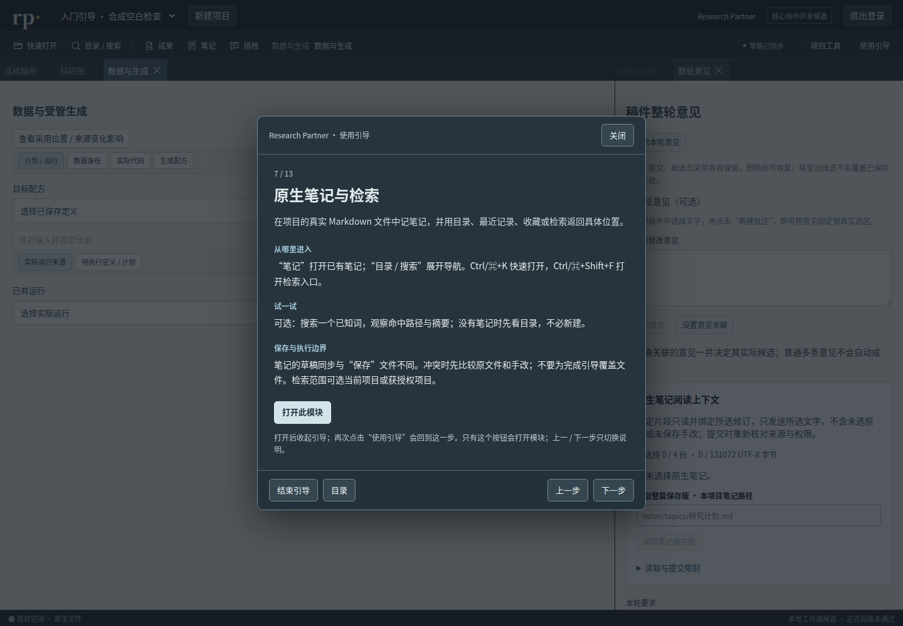

# AcaPartner · Research Partner

一个本地优先的科研协作工作桌：在同一项目里阅读和编辑稿件、整理意见、查看图与来源、记录 Markdown 笔记，并按明确授权调用科研任务。

**这是开发预览版。** 基础编辑与局部工作流已有验证，完整科研协作、全部成果类型和跨平台交付仍在完善；不把运行成功当作科学结论或正式验收。

## 开始使用

需要 **Python 3.12+**，使用 Linux/macOS；Windows 当前请用 WSL2。从本仓库下载或解压完整发布包，在根目录运行：

```sh
python3 tools/start_local.py
```

打开启动输出的本机地址（默认 `http://127.0.0.1:8877`）。首次点 **注册本地账号** 设置用户名和密码，以后直接登录。项目与账号默认保存在用户主目录的私有数据目录，源码升级不会覆盖它们。不要把该数据目录上传 GitHub。

第一次进入项目时可选择 **开始引导** 或 **稍后再看**；之后从工作桌 **使用引导** 随时重开。引导逐步介绍真实模块，只有点击“打开此模块”才导航，不自动提交意见、启动模型、重算或编译。

```sh
python3 tools/start_local.py --data-dir /your/private/acapartner --port 8877
```

发布包包含前端构建。若从仅有源码的版本开始，需要 Node.js 22.12+，先在 `frontend` 运行：

```sh
npm ci
npm run build -- --configLoader runner
```

更多说明：[快速开始](docs/quickstart.md) · [工作桌使用指南](docs/user-guide.md)。



## 在工作桌里做什么

| 模块 | 用途 |
| --- | --- |
| 项目与工作桌 | 切换项目、停靠面板，保留草稿与工作位置 |
| 连续稿件 | 阅读、直接修改文字、查看修订和真实选区批注 |
| 整轮意见 | 自主编辑、删除或恢复意见；整理后再明确提交和决定候选 |
| 科研图 | 选择图位/元素组、调整布局；区分草稿、保存版和稿内固定引用 |
| 数据与生成 | 查看数据、代码、参数、结果和依赖，按已配置环境计划重做 |
| 原生笔记 | 每项目 Markdown、目录、检索、历史和来源引用 |
| 研究委托与有限协作 | 明确材料、目标和预算，查看任务、候选和问题 |
| 问题与证据 / Claim | 查看问题、证据与稿件主张之间的关系 |
| 论文 PDF | 编译保存稿、查看当前修订，下载实际产物 |

**保存有不同含义：**“草稿已同步”保存工作状态，“保存文字/保存笔记”保存对应内容；PDF 需要另行编译；图形预览和采用也是不同动作。引导会逐步说明。

## 可选运行时与限制

默认启动是 **仅工作桌模式**，不构造任务执行器、不消费旧队列、不自动调用模型。模型、外站取得全文、绘图与数据重算需另行配置运行时、凭据和数据权限。新建项目可以保留空稿与笔记；没有 XeLaTeX 时当前 PDF 编译会明确受阻。

- PDF：XeLaTeX / BibTeX 及中文字体。
- 科学图：配置的 Python、Matplotlib 等；只能对有可验证来源的元素做对应编辑。
- 生成链：与锁定版本及安装记录匹配的 Snakemake 环境。
- Agent：已有提供者适配、明确凭据、授权材料和有限预算；本地账号不等于模型服务账号。

本预览不承诺完整科学质量、Windows 原生输入/打印、参考硬件性能、所有来源变体或完整 W4/W5 交付。完整范围保留在[产品书](docs/product/current-20261010/Research_Partner_产品书.md)、[功能清单](docs/product/04_全量功能清单.json)和[场景](docs/product/09_验收场景.md)。

## 开发与发行

后端是 Python 标准库实现，前端使用 React、Dockview、CodeMirror 与 ProseMirror。前端锁文件在 `frontend/package-lock.json`。测试和发布包含范围见 [发布说明](docs/RELEASE.md)。

仓库提供产品源码、前端构建、可分发字体和许可证及自包含测试。**不包含**使用者项目、科研数据、模型凭据、本机账号、内部运行台账、历史验收材料或旧开发 Git 历史。公开版本不改变原项目已有证据或验收结论。

## 许可证

主项目使用 [MIT](LICENSE)。附带字体的许可证位于 `research_partner/fonts`；前端依赖声明及第三方许可见 [THIRD_PARTY_NOTICES.md](THIRD_PARTY_NOTICES.md)。
