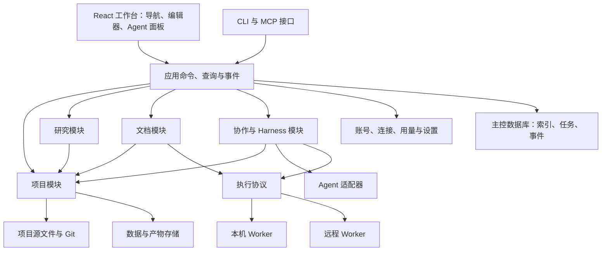

# AcaPartner 系统架构建议

状态：讨论稿，2026-10-28。用于明确目标架构、模块职责和迁移顺序；不是已实施架构或已接受 ADR。本轮只更新设计文档和已确认的领域词义，不重构代码或迁移项目数据。

## 依据与首期假设

产品已经确认：面向一线研究者的科研 IDE；人与 Agent 围绕同一项目工作；讨论与完整委托并存；并列和递归 Q 各有自己的 AEC；原始材料、研究认识、执行过程和交付表达分别维护；论文是默认必备交付，DOCX 与 LaTeX 均需实际渲染和编辑；Git 是已认可的版本协作方向。研究树和文件树是同一项目的不同视角。

首期按本地或自托管的小团队工作桌设计：一个项目由一个主控实例管理写入，浏览器连接该实例，可把执行分派到本机或 SSH 机器。多人可提交工作和修改；多人同时编辑同一文档的实时合并能力另行实施，不假定 Git 已解决此问题。主控所在机器与浏览器、计算机器可以不同。

最近的 v0.17 是独立原型，尚未迁入 React 工作桌。当前仓库已有大量可复用实现，不以整体重写为默认路线。

| 现有代码 | 已有职责 | 架构工作的方向 |
| --- | --- | --- |
| `research_partner/app.py`、`server.py`、`__main__.py` | GUI、HTTP 和 CLI 共用应用操作入口 | 收拢成按领域划分的命令与查询接口，保留兼容入口 |
| `store.py` | 对象修订、关系、任务、事件和冲突持久化 | 分清内容修订、查询索引和运行控制记录，逐类明确权威源 |
| `notebook.py`、`figure_definition.py` | 笔记 Markdown 和主图定义以文件为准 | 复用其外部修改检测、版本检查和恢复经验 |
| `project_files.py` | 从已存对象生成可恢复的受管文件镜像 | 迁移时明确“镜像文件”与“原生可编辑源文件”，保留用户外部修改 |
| `article_workspace.py`、`paper_sources.py`、`artifacts.py` | 默认文章框架、结构稿/手写 LaTeX 来源、受限导入和导出 | 形成论文格式适配接口；验证真实 DOCX 编辑回写能力，而非只看导出能力 |
| `runtime.py`、`providers.py`、`cycle.py` | 有限任务、输入冻结、预算、恢复和模型适配 | 保留机制，拆清任务协调、Agent 会话与实际进程执行职责 |
| `remote.py` | 受限的独立准备任务执行 | 扩展通用执行协议前，保持现有能力范围可识别 |
| `frontend/src/`、`mcp_workbench.py` | 正式工作桌及外部 Agent 接口 | 逐步迁入新交互，GUI/MCP/CLI 调用相同领域操作 |

## 推荐的整体形态

采用模块化单体作为主控，Agent、科学计算、文档编译放到独立执行进程。模块可以分别测试和演进，部署初期仍保持简单；远程执行通过协议连接，不要求先拆一组网络服务。



图中连线表达依赖，不表示前端可任意访问文件、执行器或数据库。研究、文档、Harness 通过项目模块读取准确版本和提交修改；具体格式或模型细节留在适配器内部。

## 模块及其接口

| 模块 | 负责 | 调用方应看到的接口 |
| --- | --- | --- |
| 工作台 | 三栏、树与标签、编辑器挂载、草稿、选区、状态栏 | 项目视图、内容视图、任务视图；不自行推断科研状态 |
| 项目 | 打开已有目录、内容身份与修订、路径、源文件读写、外部修改、快照、Git | 打开项目、读内容、保存修改、冻结输入、比较/应用候选 |
| 研究 | 背景、Q/A/E/C、材料和关联、判断历史、来源更新与影响查询 | 读问题页、关联证据、登记分析、提出/采用判断、查询影响 |
| 文档 | 默认论文、DOCX/LaTeX 适配、阅读编辑、渲染、源版本绑定、章节引用 | 打开源稿、保存、渲染、定位错误、比较改动、导出 |
| Harness | 持久任务、上下文组装、预算、步骤、暂停/恢复、候选、交接 | 整理/提交委托、查看/控制任务、查看候选；封装内部运行协议 |
| Agent 适配 | 模型或 CLI 会话、工具调用、事件和实际使用量 | 启动/接续会话、提交消息、响应工具结果、停止 |
| 执行 | 环境、资源、进程、日志、心跳、取消、产物和返回记录 | 提交冻结任务、查看状态、取产物、停止；本机/远程遵守相同合同 |
| 应用管理 | 项目目录索引、用户权限、机器、模型连接、凭据、用量和外观 | 范围明确的配置与状态；项目包中不携带凭据 |

任务协调与进程执行是不同模块：模型说“完成”不构成执行回执，进程结束也不构成研究结论。Agent 适配器不自行维护第二套科研对象库。

接口围绕完整研究动作设计，调用方不需要先拼装多份内部登记数据。保留现有 `request_key`、准确修订和冲突机制；GUI、CLI 与 MCP 的身份权限可以不同，但走相同的领域校验。

## 项目内容、数据库与 Git

每类对象指定唯一可编辑源，索引和渲染是派生物。目标是一个带结构化元数据的可携带研究项目；长期科研内容可以在离开应用后继续被理解，数据库负责高效查询及应用运行状态。

| 数据 | 建议的权威来源 | Git 的职责 |
| --- | --- | --- |
| Markdown、代码、LaTeX、DOCX、图定义 | 原生文件及其准确内容版本 | 文件历史、分支、比较和变更接纳 |
| Q/A/E/C 身份、论证关系、采用判断、固定来源 | 带 schema 版本的项目元数据 | 与内容一起形成可携带的研究版本 |
| 大数据、二进制产物 | 数据集/资产存储与内容哈希、不可变引用 | 保存清单和引用，是否跟踪实际文件按体量和访问条件决定 |
| 任务队列、执行租约、预算、事件、会话检查点 | 主控持久数据库/私有运行目录 | 不通过 Git 分支合并运行控制状态 |
| 运行证据与已采用来源记录 | 可导出的项目记录，绑定实际输入和产物 | 保存可移交的来源清单；完整日志按需携带 |
| API 凭据、机器身份、用户登录 | 实例私有配置或凭据存储 | 不进入研究项目版本 |
| 搜索索引、缩略图、PDF 预览、编辑器布局 | 可重建索引/缓存或用户工作状态 | 不替代源内容 |

示意布局仅表达职责，不强制用户搬动所有既有目录：

```text
project/
  .acapartner/             项目身份、研究对象与关联、固定来源清单
  background.md
  notes/
  data/                   实际数据或可验证的引用清单
  analysis/               代码、参数、环境说明
  results/                结果与产物清单
  manuscript/             论文源稿、图片、参考文献等
  deliverables/           按需加入的其他表达
```

对象通过稳定 ID 关联，路径不是唯一身份。研究对象逻辑上独立，不要求每个问题都预建四个空目录，也不要求 Q/A/E/C 都填完才能工作。用户已有目录可以通过项目登记接入。

当前实现同时存在文件权威和 Store 权威，迁移必须逐类进行：记录旧对象 ID/修订与新源版本的映射，保留旧数据和草稿，校验迁移结果后再切换该类写入。不能使文件镜像和数据库内容同时成为可随意互相覆盖的主源。

项目文件写入与数据库登记不能假设为一个天然跨介质事务。沿用可恢复日志、原子替换、版本检查和幂等完成登记；进程重启后能够判断写入已完成、待登记或冲突，不盲目覆盖。

主控初期继续使用本地 SQLite。通过应用接口供浏览器和远程执行访问，数据库文件不挂载给多台 SSH 主机共同写入；SQLite WAL 的共享内存要求同机进程访问，且同一时刻只有一个写入者。[SQLite WAL](https://www.sqlite.org/wal.html)

## 研究模型

长期研究状态与一次执行任务分别维护：

- 一个项目有多个并列 Q；Q 可以继续拆解，父子分别形成 AEC。
- 一个 Q 可有多条分析路线；分析可以复用，结果可以来自计算、实际实验记录、文献或人工推演。
- 结果不自动成为某个判断的证据。证据关联应说明支持、限制或反驳的对象及适用范围。
- 结论包含依据版本、条件与未决部分；来源变化引发复核提示，不能仅凭版本不同就宣称结论科学上失效。
- 一次任务可以服务多个 Q；多次执行记录归属同一任务。任务等待答复的待决事项与研究 Q 分开。
- 论文和其他交付物引用准确版本，并保留人工表达；引用更新不自动改写段落。

研究树是研究模型的导航投影，文件树是路径投影。它们都定位同一对象，不分别存两份内容。先用既有关系表和查询构造问题页，无需为了图结构先引入专用图数据库。

## Harness 的闭环

讨论可以持续引用当前项目、对象或选区；只有形成委托时才建立有范围的任务。长期上下文依据项目对象、判断和执行记录重建，会话历史作为相关材料，不承担唯一项目记忆。

```text
讨论/选区
  → 委托：目标、材料、产物、预算、行动范围
  → 输入快照：对象修订、文件哈希、数据选择、参数与环境
  → 执行尝试：Agent 会话及本机/远程运行
  → 结果和检查记录
  → 修改候选：内容变化、依据、影响与未决事项
  → 按当前版本检查后采用或继续返修
  → 项目内容更新，相关研究和交付显示影响
```

Git 提交不是完整任务输入身份。未提交的文件、选定数据、环境与参数也需要冻结或准确引用；不要求研究者为每次局部讨论先提交 Git。

Agent 修改可在任务工作树中进行，再向项目提交候选。Git worktree 支持同仓库的多个工作树，可作为这个隔离改动的机制。[Git worktree](https://git-scm.com/docs/git-worktree) 工作树只隔离内容变化；执行权限、网络访问和资源限制由执行模块落实。

结构化科研修改通过领域命令提交；代码/文稿文件的改动也可以从任务工作树导入为候选，但应用前仍由项目模块核对来源版本和当前目标版本。工作范围内连续执行，只有超出原授权、预算或发生需要判断的冲突时再交回研究者。

暂停、失败、取消和恢复保留原任务身份、尝试历史与累计用量。未知执行结果保留为未知，先查询检查点或执行器，不通过自动重试制造重复调用。模型调用预算预留、实际已知使用量、最终账单可见性分别记录。

## 论文格式适配

项目默认存在论文交付身份；源格式未选定时可以是草稿占位，不伪造一个已经存在的 `.docx` 文件。论文主源与研究关系分开登记，同一来源可以用于多个交付表达。

| 格式 | 编辑与渲染链 | 需要保留的原生内容 |
| --- | --- | --- |
| DOCX | 文档包 → 格式适配器 → 文档编辑/预览 → 写回新的 DOCX 版本 | 段落、样式、表格、图片、公式、引用等；对不支持的结构保留原件并明确编辑范围 |
| LaTeX | 入口 `.tex` 与项目文件 → 源码编辑 → 编译任务 → 对应版本 PDF/诊断 | 宏、模板、章节拆分、图片、`.bib`、编译器与相关依赖 |

DOCX 需要处理 WordprocessingML 及其多个部件，不可用纯文本或 Markdown 转换代替保真回写。[Microsoft WordprocessingML](https://learn.microsoft.com/en-us/office/open-xml/word/structure-of-a-wordprocessingml-document) LaTeX 需要识别编译入口和其引用的其他项目文件。[Overleaf Main document](https://docs.overleaf.com/getting-started/recompiling-your-project/the-main-document)

共用论文接口、章节/来源定位和采用流程，分别实现格式适配。任何转换都产生明确的新版本或新表达，不承诺两种源稿天然等价且可任意往返。既有 `paper_sources.py` 已区分结构稿与手写 LaTeX，可以复用这条约束。

Git 管理 DOCX 文件历史；文档内容比较和并发修改处理交给格式适配器。初期可通过文档修订检查和明确冲突处理保护文件，不把普通文本合并用于 DOCX 包。

渲染产物绑定源快照、依赖清单和编译配置。源稿修改后，可以继续查看标明版本的旧 PDF；编译失败时显示实际错误，不能把旧 PDF 标成当前稿。编辑和解析/编译在独立进程中执行，界面不会被大文件和长时间排版阻塞。

现有 DOCX 导入/导出与 LaTeX/PDF 能力应先用真实论文文件验证，再确定可复用范围。ProseMirror 可继续用于原生笔记和结构稿；Word 文档的格式编辑引擎需要单独验证和选型，本稿不预先锁定产品或供应商。

## 前端、事件与运行环境

正式前端继续使用 React/TypeScript。把 v0.17 的交互迁成工作台壳、共用树、标签、编辑器宿主、研究页和 Agent 面板；保留既有设计令牌与行为，不把演示状态机当正式领域逻辑。新工作台先通过独立路由接同一个后端，保留旧入口便于回退。

编辑器宿主按对象及源类型加载适配：Markdown、代码、表格、DOCX、LaTeX、PDF、图等。共用打开/关闭、准确版本、草稿保护、保存与来源上下文；各编辑器负责自己的编辑和定位能力。论文源文件可以来自多个物理文件，不要求一个标签只对应一种存储颗粒度。

查询返回项目树、问题页、稿件和任务等明确视图；修改通过命令。沿用 HTTP，增加带游标的事件流，让任务进度、源更新、连接和实际用量通知前端；重连后按事件游标恢复，重复事件可去重。长日志和大型目录分页，不依赖反复下载全量应用状态。

主控拥有项目写入协调、账号、任务、预算与凭据。远程 Worker 接受明确输入和资源范围，返回心跳、日志、产物哈希和实际运行回执；不接管科研结论，不直接写主控数据库。SSH 是连接方式，机器可用性、科学环境可用性、模型接口可用性分别表达。

底栏由同一应用状态视图供给：左侧服务状态，中间当前地址，右侧用量、设置、明暗。连接配置存在不代表已连接，缺失模型用量也不应显示成已知零值。

## 分阶段迁移

| 阶段 | 具体交付 | 完成条件 |
| --- | --- | --- |
| 1：项目与接口 | 项目/源/修订/快照/候选合同，封装现有 Store 与文件能力；新工作台接真实项目及默认论文 | 真文件可打开、保存、刷新、识别外部修改；新旧入口不产生两份研究内容 |
| 2：论文适配 | DOCX 和 LaTeX 各完成真实读取、编辑、保存、渲染的最小路径；给出支持范围 | 代表性论文的文字、图表、公式和引用检查；源版本与预览匹配，失败可定位，原文件可恢复 |
| 3：真实协作 | 接既有模型适配/队列，讨论转委托，输入冻结，产物与修改候选返回 | 在本机小数据上跑一次真实分析；可停止/恢复、查看用量并保留并发人工修改 |
| 4：研究与交付闭环 | Q/A/E/C 关系、判断采用、来源影响与局部文稿更新 | 补一批数据后，旧证据可查，新判断可审，论文更新保留无关手工文字 |
| 5：远程与团队 | SSH 执行、环境与数据可达性、可携带项目、多人修改审阅 | 网络中断不丢任务，其他研究者可在声明的环境与权限条件下接续 |

阶段可并行验证高风险格式能力，发布仍按完整可用路径推进。每阶段替换一条真实路径并保留旧实现退路，避免同时重写存储、任务系统和所有编辑器。

## 架构验收场景

1. 重命名文件后，问题与论文的稳定来源引用仍能定位；外部编辑被识别成新版本。
2. 用户和 Agent 修改同一段时，候选和人工草稿都保留，合并不依赖最后写入者覆盖。
3. 一份分析为多个 Q 提供结果，父子 Q 的判断独立；一个任务可以在有用的阴性或未决结论处结束。
4. 一项运行重试不清空预算和失败记录；已知完成不重复调用，未知结果可以继续核查。
5. DOCX 不支持的结构不会因保存被静默移除；LaTeX 编译失败不把旧渲染冒充当前稿。
6. 论文默认存在，改动论文表达不改研究 C；采用新 C 后，相关章节显示来源变化并可局部更新。
7. 主控重启后能恢复任务、候选和内容修订；远程断线不把正在运行的任务直接宣告成功或失去身份。
8. 带走项目源文件和研究元数据后可重建内容索引；涉及外部数据、工具和权限的依赖有准确清单。

## 本轮结论

先确定项目内容的权威源、修订/快照与候选接口，以及论文格式接口，再把新前端接入。复用已有编辑、任务、恢复和来源机制；通过真实项目闭环验证模块职责。本文是推荐方案，存储迁移和文档引擎选型尚未执行。
