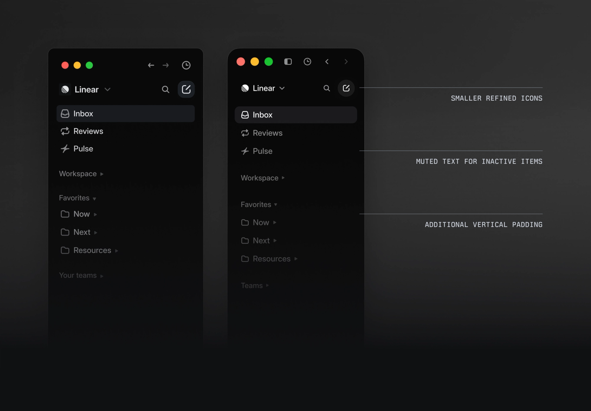
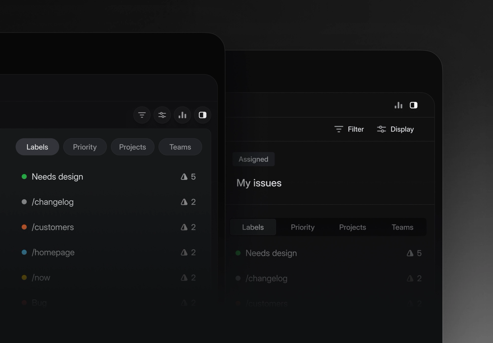
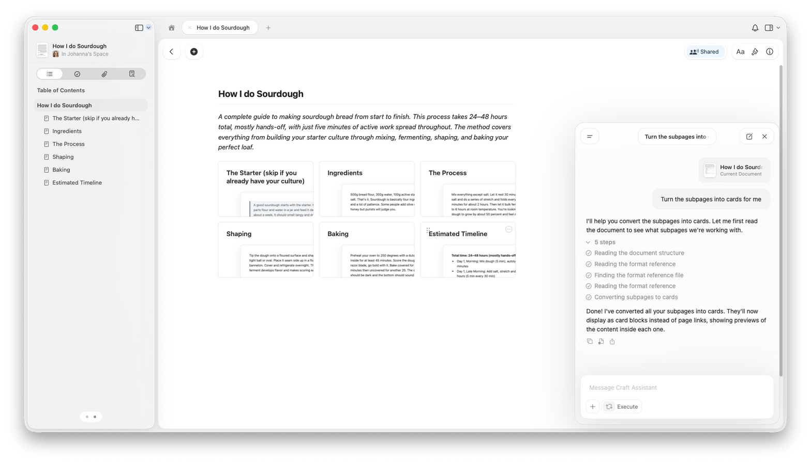
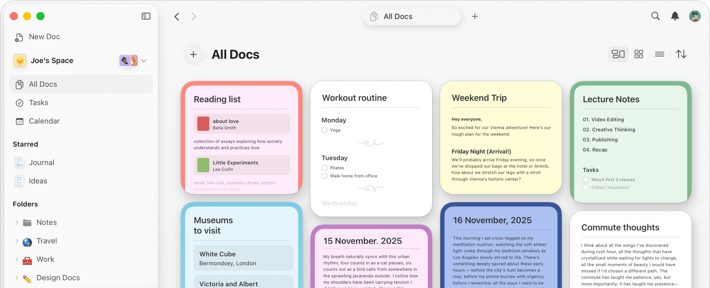

# Linear / Craft 界面调研与 AcaPartner 视觉修订方向

日期：2026-10-26。范围：官方设计复盘、产品更新、帮助文档及其中的产品截图。未登录或操作这两个产品的私人工作区；关于速度、稳定性与长期使用体验不作实测结论。官方截图可能来自不同版本，下面明确区分其用途。

用户反馈：三栏总体方向可保留，当前 UI 的视觉完成度不能接受。现有原型保留为行为验证基线；此前的技术检查及 `ship` 结论不能代表用户批准其审美。

## 判断

AcaPartner 应向 Linear 学习工作台的秩序与精度，向 Craft 学习文档的阅读、编辑及内容与助手的关系。两者在这里分别约束工具区与内容区。三栏的操作关系保留，外观需要重新建立。

上一版的问题集中在视觉权重：工具区到处有框，内容层级偏弱，暗色偏蓝，浅色也沿用灰蓝框架，Agent 的说明与按钮挤在内容旁边。增加圆角、更换强调色或换一个字体都不足以单独解决。

## Linear：工具区如何退后

### 官方证据

- [2026-03-12 设计复盘](https://linear.app/now/behind-the-latest-design-refresh)：导航退后、紧凑标签页、精简图标、减少分隔线，并将原本偏冷蓝的默认色盘向低饱和中性灰调整。
- [2026-03-12 更新说明](https://linear.app/changelog/2026-03-12-ui-refresh)：跨视图统一导航、标题与控件。
- [2024-03-28 重设计复盘](https://linear.app/now/how-we-redesigned-the-linear-ui)：讨论全局导航与内容的分工、光学对齐、主题生成，以及在真实多视图中测试设计。

图中最值得借鉴的是选中与未选中项目的权重关系，以及图标、标签与组间距的共同调整。图的深浅和比例包含演示排版处理，不能当作应用的实测像素规格。

### 对 AcaPartner 的判断与建议

- 分栏的拖动命中区可以保留宽度，静止时的视觉分隔应轻。当前两个持续可见的 4px 实线分隔条使三栏像三个拼接窗口。
- 标签页不应形成贯穿全屏的框格。保留多文件能力，弱化非活动标签，清楚标出当前内容。
- 图标的价值在识别对象和动作。文件名、路径、文件类型图标、文件夹图标不应反复传递同一信息。
- 中性背景、内容文字、导航文字、辅助文字、选择与焦点需分别定义。减弱装饰对比，不等于把正文和操作文字变得难读。
- 不照搬 issue 管理的状态密度；科研阅读与写作需要不同的节奏。

## Craft：内容如何成为主角

### 官方证据

- [Blocks and Pages](https://support.craft.do/en/write-and-edit/blocks-and-pages)：段落、图像等作为可组合单元，内容可以逐渐组织成更深层页面。
- [Styling](https://support.craft.do/en/write-and-edit/styling)：文字样式与页面样式分层，选择文字时提供就地格式操作。
- [App Styles](https://support.craft.do/en/write-and-edit/styling/app-styles)：内容与外围工具区可以共享色彩关系，工具区继续使用系统字体。
- [Editing with Craft Assistant](https://support.craft.do/en/ai-assistant/editing)：在文档旁使用助手，区分建议与直接修改，并提供撤销。
- [Organize and Find](https://support.craft.do/en/organize-and-find)：目录、搜索、链接与结构化集合共同用于找内容。

这张图最接近用户选定的工作关系：导航、中心文档、右侧助手同时存在，中央仍保有完整的阅读面。截图里的浮动助手是该场景的呈现，不意味着 AcaPartner 必须改成浮窗。

这是文档库概览，虽然本地文件名包含 editor，**并非正文编辑界面**。用于观察标题、导航与对象预览，不拿它的彩色卡片墙作为科研工作台结构。

### 对 AcaPartner 的判断与建议

- 工具区与文档使用两套相互配合的密度：操作紧凑，阅读舒展。当前原型的阅读正文为 15px、源码编辑为 14px，标题为 23px；下一版需在实际三栏宽度中一起重调标题、段落、列表与留白。
- 中央笔记呈现为可持续写作的研究文档；元数据与演示标记保留必要信息，但不围在标题周围形成一排辅助说明。
- 根据对象分配阅读宽度：笔记与稿件限制行长，数据表和科研图可展开，代码保留独立的等宽排版。
- Agent 首屏应简洁，引用材料和正在处理的内容清楚可见；反复解释能力和摆放多组起始按钮会消耗注意力。
- 内容逐渐结构化适合科研探索。不能因采用块式交互就假定普通目录、Git 或真实文件不再需要。
- 不将封面、纸张背景、彩色卡片及装饰性样式设为科研正文的默认外观。那些是 Craft 可选的表达能力。

## 当前原型与下一版的具体变化

以下均为基于参考的设计判断，不是两家产品对 AcaPartner 的建议。

| 部位 | 当前问题 | 下一版处理 |
| --- | --- | --- |
| 整体表面 | 大面积冷蓝灰，浅色仍像同一套框架反相 | 先验证中性浅色主画面，同时维护独立调校的暗色；用表面明度而非重边框区分区域 |
| 顶部 | 品牌、项目切换、标签、路径和动作形成连续条带 | 明确全局位置、打开内容、当前对象动作的分工；删减重复信息，统一对齐 |
| 左侧 | 文件夹、类型图标、扩展名和重复标题过多，选中蓝块偏重 | 保留目录树，减弱非活动项，稳定缩进与基线；以对象名为主，路径与格式按需要显露 |
| 中央文档 | 标题、正文与辅助文字的尺度接近；整页节奏单一 | 重调中文与英文混排、行长、段距、标题层级；让首屏先读到研究问题 |
| Agent | 导语、解释、建议按钮、上下文、输入框同时争夺注意力 | 精简空状态，保留一处明确的发起入口；回复、引用与任务状态分层 |
| 控件 | 多个常驻描边按钮，视觉重量接近 | 明确主次与就地动作；次要操作按 hover/focus 或上下文显露，键盘仍可达 |
| 状态 | 把很多系统说明长期铺在工作面 | 正常状态安静；保存失败、执行受阻、修改冲突在发生时清楚呈现 |
| 分隔与圆角 | 分栏重，组件细节各自成立但缺乏整体秩序 | 保留可抓取边界，用更轻的静止状态；按控件、容器、浮层分别定义形状 |

## 下一次视觉验证的交付与判断标准

先在同一条已有流程上重做视觉：打开研究笔记 → 选区讨论 → 整理委托 → 审阅候选。保持操作模型，避免一边改变美术、一边重新发明产品流程。

验证四个画面：浅色研究笔记、暗色同一笔记、已有讨论的 Agent、返回候选后的审阅。各画面使用同一套代表内容，不能靠空白和删掉功能制造整洁。

建议第一轮起点（AcaPartner 的待验证值，并非从官方像素量测获得）：导航文字约 13px，正文约 16px，文档标题约 28px；更弱的灰阶选中背景；窄且低对比的分栏视觉边界。最终值以中文、长文件名、实际视口和可访问性检查为准。

审查重点：第一眼能找到当前内容与当前操作；导航与 Agent 不压过正文；鼠标与键盘能识别交互；内容增加后仍然清楚；明暗主题各自成立；人工编辑的保护不因简化外观而消失。

等这一版画面经使用反馈稳定后，再从实现提取 tokens、组件及设计规范（当前维护于 `docs/design-system.md`）。当前原型可以用于测试操作，不作为已经批准的视觉样板。

## 参考素材与限制

`references/sources.json` 记录每张图的官方页面、下载地址、抓取日期和校验值。截图只供调研，未加入工作台资源或复制其品牌元素。

`linear-structure.png` 为 2024 年的结构标注，不能代表 2026 年现状；`linear-2026-refresh.png` 为局部宣传图，不能据此评估完整工作流。Craft 帮助页面的截图无统一版本标记；只就可见内容作设计观察。关于正文体验的判断主要参考 `craft-assistant.png`，不能用首页概览冒充编辑器实测。
