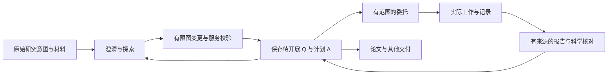

# 研究工作流与开发计划

更新：2026-11-05。本文记录已确认的工作方向、当前实现和待开发计划；里程碑不是功能已完成声明。领域词义以[领域词表](../product/glossary.md)为准，系统总体方向见[架构提案](../architecture/system-architecture-proposal.md)，实际文稿能力见[适配记录](../architecture/document-adapters.md)。

## 全流程体验评审

用户明确的两类起点为一个 idea 或已经做了一半的研究。当前功能技术闭环不等于可理解的使用闭环；2026-11-03 的[全流程 UX 复盘](ux-review-2026-11-03.md)记录独立评审、真实浏览器证据及拟调整主线。本轮已按“项目先理解现状、一个输入讨论与工作”的方向接入以下主线。多阶段计划继续保留；技术与交互回归不代替后续真实研究者使用验证。

## 当前入口：连续的项目搭档

当前主图已接入[自由研究图](free-research-graph.md)：项目是唯一根，Q 保留既有身份，A/E/C 为独立对象；父 Q 只组织子 Q，叶 Q 承载 A/E/C；支持 Q 之间的前置条件、一叶 Q 多 A、每 A 最多一 E、多 E 汇入 C，以及准确版本下的 API 操作。GUI 搭档已接入逐轮有限图变更，合同见[图接口](research-graph-api.md#搭档图变更)，所有权与事务见[接入记录](../architecture/partner-graph-changes.md)。旧候选向独立多 A 图的自动映射仍未接入，不将此路径视为完整自主科研系统。
- 新进入首页时先到记住且当前可见的项目研究进展；没有可用记录时选择最近更新的可见项目。项目切换先到进展图，保留已有标签与草稿；浏览器刷新恢复原工作位置。顶部当前认识取顶层叶 Q 或父 Q 的末尾直接子 Q 的有效保存版结论，并显示实际叶 Q 编号（本例为 Q1.3），缺少结论时显示项目说明或缺口；搭档回复继续在讨论和记录中读取。
- 一个输入处理讨论与独立图整理；新消息使用 `graph_mode:"edit"`，有效图变更原子保存并自动刷新画布，无需进入第二次采用。回复留在右侧，普通讨论允许不改图。既有专用探索/工作草稿与旧候选继续按原合同审阅，不再作为起步时必须选择的分类。
- 项目背景、最新图的紧凑快照、选中节点准确正文、已选 Q/登记文字、`notes/**/*.md` 和 `scripts/*.py` 保存全文成为明确输入。GUI 每次最多选择8项保存来源（Q最多4个、原生文件最多4份）；图快照最多80节点（含根）、160条关系记录，完整上下文45000字节内，超限拒绝而不截断。未选中节点只带摘要；DOCX、图片、数据表、未保存草稿及通用项目目录导入仍未接入这个读取合同。
- 默认值来自当前查看内容和少量已有材料，可展开复核/取消。发送执行一次有预算的任务，不再跳转表单；没有配置或运行服务时显示具体缺口。
- 新 Q/A 待开展；新 E/C 需本轮用户原话或选定保存材料的逐字依据及准确来源，保持待确认。每轮原话另存不可编辑来源。已有节点身份和无关内容保留，替换正文要求该保存版已经入上下文；不运行脚本、修改文件或作出科学确认。
- 回复内显示应用、冲突或撤销回执。并发图变化时保留候选但不覆盖；研究者可整轮撤销，后端核对应用后的图签名，保留归档节点、撤回关系与旧修订，拒绝抹去后续工作。旧文字恢复不恢复科学确认有效性。

### 当前自由研究图

`workbench.graph.read/history` 读取 Store 的独立对象与 `graph_growth` 关系历史；不另建图数据库。项目根在画布中显示 Q，项目名保留在页头和点击后的详情；桌面问题图默认显示根与全部 Q，手机起始显示根与顶层 Q，原总体 Q 从根详情进入原记录。父 Q 有有效直接子 Q，不直接拥有 A 或回答 C；叶 Q 可引出多个 A，A/E/C 随所属叶 Q 编号并各自保留正文和修订。综合判断是最后一个明确的叶子 Q；不自动补齐空槽。主画布标明“最新版本”，不展示历史节点或修订连线。

当前画布以内容卡片显示编号、状态、标题和保存内容摘录，证据保留表头与分母，节选有明确说明；缩远逐级隐藏摘要，矩形几何与关系保持稳定。已完成Q初次收起，未完成Q初次展开；卡片主体选择并阅读下部详情，独立箭头展开/收起子Q或已有AEC，始终留在同一画布。树与搜索显露祖先并定位，滚轮缩放、拖动平移、明确聚焦与查看全局帮助继续阅读。AEC编号跟随所属叶Q，稳定ID、来源、历史和科学确认不由界面变化改写。布局复用本地Graphviz与React Flow；原有记录和编辑仍可从明确入口读取。具体交互见[工作台指南](../workbench-guide.md)，矩形与共享线实现见[布局接入](../architecture/research-graph-layout.md)。

节点记录待开展、进行中、待确认、已完成或暂缓，兼容未标记旧内容，不从已有文字或任务状态推断完成。确认需具体标题、非空正文、核对说明与准确依赖签名，绑定内容、来源、范围、关系版本，并通过不可变确认记录核验。E 需要唯一产生它的 A 完成；C 需要声明的支持/限制/反驳证据完成；叶 Q 需要回答结论和所声明前置 Q 完成；父 Q 需要全部直接子 Q 和所声明前置 Q 完成，不直接拥有 A 或回答 C。两类 Q 均须独立核对说明、准确依赖签名和足以作答的明确确认；子 Q 全部完成不自动完成父 Q。阴性结果可回答，证据不足仍未完成或暂缓。

叶 Q→A 绑定分析范围而不等待 Q 完成；父→子 `contains` 的完成签名反向绑定子 Q→父 Q，父 Q 依赖全部直接子 Q，子 Q 变化可逐层使父确认待复核。项目根包含只组织内容，不增加根 AEC。完成依赖与问题拆解分别拒绝循环，允许科学语义 Q→A→E→C→Q 回指。正文、标题、来源、范围、关系或依赖签名变化后，当前确认和下游待复核；恢复旧文字仍需重新核对。原正文、人工进度和确认保留，不自动改写结论。

点击节点先读取最新正文；历史只在只读检查器内显示对象保存版，可加载更早版本并返回最新，主图不变。选择、项目、关闭或请求代次变化后，晚到的历史读取不能进入新选择。新建与编辑草稿按项目、浏览器窗口与节点保留，切换、关闭、取消或刷新后由“草稿”入口恢复、下载或明确删除；保存冲突保留输入，存储失败提示下载。

所有图修改核对项目及对象准确修订，使用项目权限、CAS、稳定请求键与事务。旧项目通过明确的 `workbench.graph.migrate` 提取非空 AEC，保留 Q 身份、全部原 QAEC 正文及历史、原总体问题、论文、材料、笔记和任务。父 Q 的已有 AEC 会自动接入末尾子 Q；仅已认证且仍满足新依赖的旧确认可转移，不能从文本或搬移推断科学完成。页面读取不自动迁移、确认或派发模型。原 `workbench.progress.*`、`workbench.node.save` 与 `workbench.root.set` 继续服务旧 QAEC 记录兼容，不能作为独立图合同使用。

“拆分并迁移”使用 `workbench.graph.question.organize`：原子建立子 Q、撤回原分析/回答关系并保留历史，再将原 A/E/C 接到新叶 Q；对象身份、正文和旧修订保留，范围变化后重新核对。父 Q 只提供子 Q 创建，叶 Q 有 AEC 时新建子 Q 自动走整理合同；共享创建守卫使侧栏与旧 Q 创建入口不能绕过。旧混合父 Q 可读且可修复，但不能完成或扩大混合关系。合同仍复用 Store、CAS、幂等与权限；运行时标识为 `leaf_research_questions_v1`，项目标记 `research_graph_question_model=leaf_v1`。

### 合同与复用边界

`project_partner.py` 增加 `research.partner.preview/submit/read/history`，任务类型为 `research_partner`，功能标识 `project_partner_v1`。保存仍由 `research_tasks.py`、原 Store/Runtime/Providers 持有；没有新建对话数据库、队列或自动多轮 Agent 循环。发送使用已有的准确输入 pin、稳定请求键、有限预算和授权复核。一次分派不等于可观察内部 API 请求数，实际费用缺失时保持未知。

图模式候选由 `partner_reply` 与可空的 `graph_change` 组成，后者包含新建 Q/A/E/C、已有节点更新、具名关系和可选背景更新。`research_graph_changes.py` 只负责冻结图、校验、成批应用和撤销；`research_tasks.publish` 仍在授权及实际模型回执核对后发布回复，并在同一写事务内调用图应用。成批关系不合法时回滚图内所有修改，保留回复与未应用说明；图签名变化时同样不覆盖。运行时标识为 `partner_graph_changes_v1`，继续复用已有 Store、Runtime、提供者及恢复机制，不增加运行器或数据库。

省略 `graph_mode` 的旧搭档任务只有一份 `partner_reply` 正文，可另外携带一个 `research_proposal` 或 `research_update`；普通讨论允许两者均空。问题提案和 AEC 继续复用原有校验与采用事务，分别经 `research.partner.questions.read/adopt`、`research.partner.work.read/adopt` 进入已有审阅组件。**旧合同及 `research.work.*` 仍是每 Q 一组 QAEC，尚未自动映射到独立多 A 图。** 旧 QAEC 须先明确导入研究图，才能接受图模式自动应用；原记录与原编辑器继续保留。图模式也不接受删除、重新归属已有 Q 或自动拆分有 AEC 的叶 Q，后者仍须明确调用整理接口；两类合同均不给 Agent 科学完成确认权。

`research_context.py` 通过既有文件适配器的目录描述符、路径和链接检查读取原生保存版，提交时重读核对 pin。与任务及 grant 同事务登记以项目/路径/SHA寻址的不可编辑输入修订，复用 Store 来源引用，不在用户目录另建可编辑文件。原生文件在入队后变化不替换旧输入；同一提交重放先查原账本，原文件已删除也不会重复派发。前序讨论最多带四轮正文，来源权限在后续执行、发布、读取与采用时仍重新检查。

旧合同中选定 Q 的节点名称和确认记录作为 `recorded_node_decisions` 随准确保存版本进入 Agent 上下文，保留原来源 pin；该记录不证明独立图依赖仍然当前有效。图模式使用最新独立图快照；无论哪种合同，都不授权 Agent 确认完成或作出科学审批。

### 本轮验证

输入到图扩展已在隔离工作区完成一次真实 Codex 分派：生成2个 Q、2个待开展 A 和一条 Q 前置关系，回执为已应用，没有生成 E/C。相关后端177项、无头浏览器19项检查及前端构建通过；截图由真实 Store/Runtime 和确定性提供者生成，覆盖应用、来源、选中分析、报告性 E/C、并发冲突、撤销和明暗窄屏。原科学煮蛋34节点、49条有效关系及科学确认数据未因本轮改变。证据位置与验证限制见[接入记录](../architecture/partner-graph-changes.md#验证与边界)。

此前旧合同的隔离工作区完成三次真实 Codex 分派：无 Q 的自然讨论、澄清后返回一个问题提案、读取实际保存的 Markdown 与 Python 后返回 A/E/C 候选。浏览器改写问题后采用，随后只采用人工编辑的 C；A、E、Q 状态保留，脚本没有执行，用户项目没有加入这些验收数据。

确定性回归覆盖两种起点、丢失提交/采用响应后的同请求重放、原生正文版本、过期 Q、局部采用、草稿隔离、键盘搜索与窄屏。CRG用于定位和影响复核，已包含未跟踪的新源码；测试结果与图的静态风险评分分别记录。

## 开发目标

研究者带着一个想法进入项目，人与 Agent 一起形成研究问题，再通过有范围的工作逐步积累分析、证据和结论，并组织为论文等交付物。讨论与委托并存：共同探索可以改变方向，明确交出的工作进入已有 Harness。

QAEC 是研究认识的组织方式，不是必须依次填完的表单或四个执行步骤。允许多个并列 Q、递归子 Q、自由记录与未完成的 AEC。父 Q 保留问题正文与独立完成核对，叶 Q 保留 A/E/C 判断；父 Q 完成绑定所有直接子 Q，任务前置关系另行表达。项目从创建时保留论文交付身份，研究与论文可同时推进。

本轮已接入项目根、独立 Q/A/E/C、语义关系、节点进度与版本绑定完成确认，具体合同见上方“当前自由研究图”。Q 完成表示“问题已得到回答”，不能由任务完成或已有文字代替。该实现复用现有 Store，不等于完整科研 Harness 或自动科学验证；项目仍可保存多个问题和其他研究内容。

## 当前基线与核对依据

本次使用 CRG 查询模块、调用方和测试位置，再核对当前源码；图的风险分数、静态调用边和“未发现测试”不直接作为缺陷或完整覆盖结论。索引覆盖当前工作树，包括尚未跟踪的新源码。

| 路径 | 已有能力 | 本计划依赖的实际限制 |
| --- | --- | --- |
| `app.py`、`resolver.py` | 统一命令入口、材料解析、准确修订、提交前复核 | `prepare_submission` 被普通委托及 cycle 共用；新 QAEC 正文不在当前科学内容投影中；通用 resolver 不读取原生正文；搭档入口另用准确保存版适配 |
| `commission.py`、`runtime.py`、`providers.py` | 有限任务、候选校验、来源冻结、用量与恢复、Codex 等适配 | 通用候选合同被多个执行路径使用；不能全局放开字段来接问题提案 |
| `cycle.py`、`questions.py` | 规划、分工、审查、返修、整合；待决事项与指导 | planner 的任务问题和 `questions` 不等于项目研究 Q；真实多阶段协作尚待单独验证 |
| `workbench_research.py`、`ResearchEditor.tsx` | 背景、原 Q/QAEC、树序、旧记录与草稿；研究树接入独立图状态 | 旧 QAEC 编辑器与候选合同保留，不隐式覆盖独立 A/E/C |
| `research_graph.py`、`research_graph_changes.py`、`FreeResearchGraph.tsx` | 项目根、独立节点、语义关系、来源登记、完成签名、迁移、有限搭档图变更与整轮撤销 | 旧候选向多 A 图映射、自动多轮科研和模型科学确认未接入；计算另走生成合同 |
| `ResearchCommissionPanel.tsx`、`ContentPanels.tsx` | 项目委托、保存材料预览、任务详情、固定候选读取 | 搭档连续讨论已接入专属合同；通用委托和旧草稿保留，真实计算另走生成合同 |
| `generation.py`、`generation_batch.py`、`generation_checkpoint.py` | 受管数据、脚本、计划、授权、运行和检查点 | 需要核验的科学环境与运行时安装记录；可查看的示例脚本不等于已登记可执行计划 |
| `claims.py`、`scientific_trace.py`、`documents.py`、`manuscript_revision.py` | 固定来源、支持关系、文稿文件交接及部分修订合同 | 结构稿修订不能直接视为原生 DOCX 段落修改；不同文稿源类型须单独验证 |

已完成一次真实 Codex 普通委托：读取科学煮蛋的两份固定报告，生成可在工作台读取的新报告。验证了模型执行与候选返回；未在该次调用中重算数据、采用 Q 的 C 或修改论文。macOS 通用子进程的身份、超时与清理已有实际测试。默认启动器仍保持工作桌模式，任务运行器需明确启用，见[快速开始](../quickstart.md#明确启用-agent-任务运行器)。

## 开发约束

- 沿用 App/Store、任务身份、现有运行器、提供者、预算和来源机制。首轮不迁移项目存储、不引入另一套会话数据库或任务队列。
- 原始意图可先由任务请求及已有指导记录持久保存；正式 Q 不是提交探索工作的前提。用户已有明确 Q 时可以直接登记并工作。
- 科研问题提案采用专属、带版本的候选合同；既有 `questions` 继续表示待决事项，图谱概念提案也不自动成为研究 Q。
- 无材料的探索是合法入口。区分用户目标、待核实假设与实际来源；不得为了通过来源校验给探索想法伪造证据。
- 研究内容与采用结果继续使用现有对象和修订机制。每次写入核对当前权限、准确来源与目标版本；保留人工草稿、旧候选及失败历史。
- Agent 在已授权工作范围内连续推进。澄清仅围绕会影响本次工作的缺失信息；探索通常可先返回有条件的方向，不以未开展的未来实验阻断当前工作。
- 先验证一条完整使用路径，再扩展自动化。每个可交付批次以用户行为验收，不以新增了几个接口作为完成标准。

## 里程碑一：从想法形成第一批 Q

以下里程碑一、二保留专用探索与每 Q 一组 QAEC 合同的实现过程及验收。当前 GUI 图模式的直接保存路径见上方“当前入口”，不把旧任务隐式改为新合同。

首轮实现已接入现有右侧区域和中央内容页，保持项目树、标签、编辑器及设计令牌一致。以下为专用探索合同基线：已授权 Codex CLI、项目背景和明确选定的登记文字对象。现行连续讨论与原生文件适配见上方“当前入口”；cycle 探索仍未接入。

### 用户能完成的过程

1. 新项目没有 Q 时，输入一句原始想法，并可选择已有材料。系统显示本次采用的保存版本与范围。
2. 明确开始探索后，以有限预算运行一次任务；用户能看到真实状态、失败原因和已有回执。
3. 返回候选方向、形成理由和需要澄清的事项。用户可以补充目标，修订同一探索的提案，或直接改写、暂存、采用某些候选。
4. 采用时创建具有稳定 ID 的项目 Q，能追溯到原始请求、用户补充、提案版本和采用材料。A 可保留初步路线；E/C 不因创建 Q 自动填入。

### 最小合同与权威来源

| 内容 | 需要保留的身份与含义 | 复用方式 |
| --- | --- | --- |
| 探索输入 | 项目、原始请求、采用的背景/材料版本、用户补充、预算与范围 | 固定任务请求/上下文、现有指导事件与来源解析；浏览器草稿仍归各窗口所有 |
| 问题提案 | 合同版本、稳定候选 ID、问题表述、未知、形成理由、依据/假设、分析设想、需要的证据 | 保存在现有成果修订中；提案正文与结构化字段是同一份候选的投影，不维护两个可独立覆盖的主源 |
| 提案修订 | 基础提案 ID/修订、补充意见、前后继任务及候选版本 | 运行中意见使用既有指导机制；任务已生成后创建明确关联的后继任务，不把 `guide` 当作隐式重新执行 |
| 采用记录 | 精确候选版本与候选 ID、用户最终表述、来源集合、返回的 Q ID、请求标识 | 与 Q 创建/关联在同一 Store 事务中登记；模型没有自行写入或采用的权限 |

提案可有多个问题，也可先只有待澄清方向；不强制一个主 Q 或固定候选数量。首轮界面优先选择、改写、暂存和采用；复杂批量合并/拆分可以后续完善，来源关联允许保留多个形成依据。

已完成提案的继续探索是一轮明确的新工作：显示本轮有限预算和前序任务的累计用量。回答澄清事项本身不扩大调用权限；原任务的接续使用其剩余额度，不能通过自动创建后继任务清零预算或绕过失败次数。

当前界面逐轮显示既有预算、完成回执及可得的 Token 用量；没有返回的用量或费用保持未知。每轮最多一次 CLI 分派，不把分派次数解释为内部 API 请求次数。专用探索草稿仍先预览、再开始；现行统一入口在发送时自动核对保存版，不自动派发下一轮。

### 推荐实现顺序

| 批次 | 交付与主要改动位置 | 批次完成条件 |
| --- | --- | --- |
| 1A：输入与提案合同 | 一个内聚的研究探索模块；接入 `app.py`，通过限定任务范围复用 `commission.py` / `runtime.py` / `providers.py`；补齐准确背景与已选择内容的输入适配 | 无 Q、无材料也能返回合法提案；原有普通报告合同与历史任务读取保持有效；没有不支持字段被静默丢弃 |
| 1B：修订与采用 | 扩展现有研究对象写入路径与 Store 事务；返回提案版本、采用记录和 Q 映射 | 可改写后采用；成功但响应丢失时可核对并重放同一请求，返回相同 Q；过期或跨项目来源拒绝新写入且保留双方内容 |
| 1C：工作台完整交互 | 接现有输入区、委托与任务组件；提供提案阅读、补充意见、改写和采用；复用草稿、树刷新与标签导航 | 两个验收场景均可由用户在界面完成，刷新后能接续，没有必须通过终端补做的步骤 |

三个批次已接通。应用接口为 `research.exploration.preview/submit/read/adopt`，通过既有 `/api/action` 使用相同账号、权限与 CSRF。`preview` 固定输入且不调用模型；`submit` 要求原预览的 `input_pin`、有限预算和稳定 `request_key`；`read` 读取任务实际产出的固定提案；`adopt` 要求准确的提案 ID/修订/SHA、候选 ID、最终标题和独立请求标识。采用与 Q 创建、来源关系、采用账本在同一事务中完成。模型返回的普通待决事项没有转成研究 Q。

输入适配先处理明确选中的保存版内容。原生笔记需要通过其已有读取接口取得准确文本及身份，不因为模型提示中有一个文件路径就声称读取过全文。未保存选区要明确作为临时输入快照处理，不能冒充项目保存版，也不自动保存整份文档。

首次真实验收优先使用已验证的 Codex 普通任务路线。新增合同对其他提供者未验证时应明确可用范围，不因它们共用候选校验器就宣称全部适配。多阶段 cycle 可在后续独立验收后接入同一领域合同。

### 两个首发验收场景

**场景 A：只有一句模糊想法。** 空项目输入“我想研究怎么把鸡蛋煮得更好”，Agent 提出方向与关键澄清；用户补充关注蛋白凝固、蛋黄柔软；提案据此修订，用户采用一个问题，左树出现 Q。全过程不读取不存在的资料、不编造当前研究结果、不自动填造 E/C。

**场景 B：已有材料但目标改变。** 用户选择固定版本的已有记录，先关注口感、随后改为关注方法对大小与初温的适用范围。旧提案保留，新提案指明变化和仍然适用的材料；采用后能查到两轮输入与最终选择。资料尚未涉及冷热交替法时，不把它预设为必选研究方向。

## 里程碑二：从 Q 发起工作，候选回到 AEC

前置：里程碑一通过，任务与提案已有稳定来源和采用机制。

本轮完成主链：Q 范围输入、一次有限工作、固定 AEC 候选、差异编辑及局部采用；多阶段 cycle 接入仍作为下一批独立实现与验证，不将一次模型调用宣称为多阶段科研协作。

- 提交时携带明确 Q ID/修订、当前 AEC、选定材料及工作范围；一个任务可服务多个 Q。任务关联与 Q 的父子关系分别维护。
- 修复研究内容投影遗漏，新增字段只在明确的科研内容范围内传递。复用 `resolver.py` 的预览、准确版本和提交前复核；不把项目连接、凭据等无关运行设置作为科研材料。
- Q 页能读到关联任务、实际执行记录、候选和来源版本。返回内容说明建议修改的段落与依据，用户可比较、编辑、局部采用或保留旧判断。
- 沿用原有版本检查与窗口草稿保护；Agent 返回期间人工修改同一 Q 时保留候选与草稿，发生冲突时停止覆盖。
- 接入 `cycle.submit/view/control` 的真实规划、审查与返修记录，并以一次多阶段实测验证状态、预算和交接；独立审查通过仍不表示科学结论成立。

完成条件：从 Q1 发起一次基于已有结果的比较工作，候选可部分采用进 Q1 的 AEC；来源可追溯，其他 Q、人工文字和旧判断不受影响。补充结果后可继续原研究问题，形成新任务与新候选，不覆盖旧执行历史。

### 当前实现与验收

本节描述原每 Q 一组 QAEC 的工作合同；其候选采用尚未自动映射到独立多 A 图。图 API 的读写能力不代表此任务合同已升级。

- `research.work.preview/submit/read/adopt` 通过既有 `/api/action` 使用。输入将目标 Q 的完整保存版 QAEC、准确修订、允许修改的 AEC 和已选材料冻结；通用委托的候选合同未全局放开新字段。
- 问题探索与 Q 工作共用 `research_tasks.py` 中的输入适配、有限派发、权限复核、固定候选读取和事务发布；继续由原 Store/Runtime/Providers 持有任务、执行、预算及检查点，不增加队列或会话数据库。
- `research_update` 合同区分增加段落和替换某部分全文，并要求修改理由、依据类型与准确来源。支持性 E/C 至少引用一份选定的非目标材料，目标 Q 本身不作为自己的独立证据；不足时允许分析计划、未决判断或无修改返回。
- 采用明确提交选中修改、人工最终文字与已核对的目标 Q 修订/SHA。目标版本变化时整批拒绝；重新核对后才可采用。正文、来源记录、关系和幂等账本在同一事务中保存；不自动改 Q、状态、未选择的 AEC 或其他问题。
- 工作台提供同窗口草稿保护、保存版重新核对、CM6 差异编辑、刷新接续及响应丢失后的同一请求核对。采用后的来源入口和 Q 页相关任务使用稳定身份；旧来源、旧候选与原判断仍保留。

独立工作区已完成一次真实 Codex 调用：读取科学煮蛋的两份既有报告，返回 A/E/C 候选；通过浏览器只采用 A 和 C，原人工分析开头、E、Q 状态及另一问题保持原样。没有重新计算、运行示例脚本或写入用户项目。确定性浏览器回归另外覆盖期间的人工草稿、保存冲突、改写后仅采用 C、响应丢失重放、多 Q 独立范围和后续工作；应用测试覆盖原子回滚、并发采用、来源版本和权限、恢复后授权撤销。

## 里程碑三：把真实计算接进研究过程

前置：里程碑二的任务关联与来源读取可用。先处理现有科学煮蛋脚本，不扩展到任意计算平台。

- 通过既有数据快照和脚本接口登记输入、分析及绘图依赖，再走 `build.plan/authorize/start/status`。核对科学 Python、Snakemake、锁文件与实际安装记录；缺失的环境记录不能用一个手写“已安装”标志替代。
- 分别记录代码、参数、环境、输入哈希、执行尝试、日志和实际产物。修改工作副本不改旧源快照；失败、暂停及接续继续使用既有检查点规则。
- 分析结果与图返回对应 Q；登记支持或限制关系时保留解释。代码运行成功和文件哈希正确只证明实际执行及完整性，不自动证明科学判断正确。

完成条件：在声明的本机环境中，由工作台发起煮蛋分析与绘图；能从图或判断追溯到准确运行、脚本和数据。输入或参数变化可形成新版本；重跑和复用有明确记录，旧结果仍可查看。跨机器能力单独验证。

## 里程碑四：研究判断与论文表达联动

论文身份及人工编辑从项目开始就存在；本阶段新增科研来源关联与修改候选。

- 复用已有固定来源、Claim 和科学溯源能力，定位论文采用的研究结果与判断。上游更新产生复核提示，论文文字通过明确候选修改。
- 先选择一种真实主源完成代表性局部修订。原生 DOCX 的段落定位、修订及保真必须走文档适配；LaTeX 按源码及编译身份处理。旧结构稿合同不作为原生格式已接通的证明。
- 采用局部变化时核对稿件版本，保留无关人工文字及来源历史；编译或导出绑定实际源版本。

完成条件：一个研究判断更新后，能找到关联的论文表达、查看准确前后差异、采用局部变化并重开文稿核对；不强制转换另一种源格式或重写整篇论文。

## 验证与发布纪律

| 验证层 | 必须覆盖的行为 |
| --- | --- |
| 应用接口 | 无 Q/无材料、材料变化、身份权限、提案格式错误、候选修订与采用、来源可访问性、成功但响应丢失、成功后目录变化时的同一请求核对/重放、并发冲突 |
| 运行与恢复 | 原请求结果不确定时核对同一身份；刷新/重启不重复调用模型；失败或停止保留尝试与累计用量；预算耗尽有可处理的状态 |
| 浏览器 | 两个首发场景、未保存输入、切项目、刷新接续、提案改写/暂存/采用、键盘操作、长内容滚动及窄屏布局 |
| 兼容回归 | 原有普通委托、待决事项、Q 编号/父子关系、笔记、默认论文、文稿草稿及文件交接 |
| 真实提供者 | 仅对确实改变的路线进行有限实测；先在隔离测试项目验证，核对实际回执、可读输出和计量口径，再进入用户项目 |

测试从应用接口或实际交互进入，优先锁住跨模块行为；不以逐字段复制实现的测试替代验收。错误注入与测试替身负责大部分回归，真实模型调用负责最后的代表性验证。用量未知时保留未知，不把 CLI 分派次数当作已知 API 请求数或金额。

浏览器测试与截图默认无头运行；只有用户明确要求时才使用可见浏览器。

每个批次先查 CRG 定位调用方、影响范围与测试，再用当前源码确认；代码改动后更新索引，包括未跟踪源码，并检查其可查询。图分析补充人工审查和测试，不替代它们。新合同需明确版本与兼容范围；现有项目的迁移采用显式、可核对的增量方式。

每阶段通过后再扩展下一阶段。Git 项目可携带与内容权威迁移、SSH、多人协作、格式互转和无限自主研究属于后续独立工作，不作为首个探索闭环的前置依赖。当前项目原件、资产、草稿、凭据和私有运行记录不进入示例或公开发行包。

## 示例与范围

[科学煮蛋项目](../../examples/scientific-egg/README.md)是现有完整可复现实例：480枚合成样本、实际脚本、图、结果与文章。新增探索验收应从一个没有预置 Q 的隔离项目开始，避免把预先写好的 Q1/Q2 当成模型从模糊意图形成问题的证明；已有实例用于后续 Q 工作、计算和论文联动验收。

早期六样本浏览器模拟及其页面剧本已移除，不保留并行演示版本。里程碑一已在隔离工作区完成两轮真实 Codex 探索和浏览器采用：从模糊想法开始，补充口感目标后返回新提案，人工改写并采用为 Q1；E/C 为空，原始请求与两轮提案可追溯。现有用户项目没有加入验收数据。

确定性浏览器回归另外覆盖响应丢失后的同一请求核对、刷新接续、已有材料与目标改变、背景变更后的过期预览、切项目后的晚到读取、树刷新、明暗主题与窄屏滚动。应用回归覆盖合同、来源权限撤回、备份恢复授权撤销、发布回滚、采用原子性及同一请求的并发采用。里程碑二主链已接通，多阶段 cycle 及里程碑三至四仍待开发与验收。
