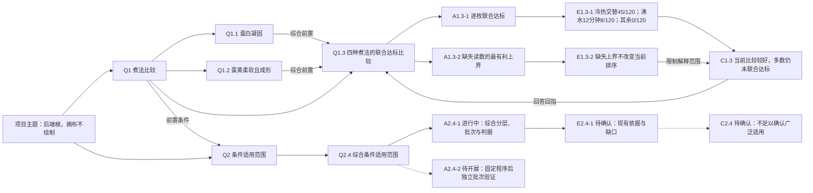

# 自由研究图：当前模型与科学煮蛋

当前工作台主图使用独立研究对象、有版本语义关系及父/叶问题规则；右侧输入已接入逐轮有限图变更。界面操作见[工作台指南](../workbench-guide.md)，字段、权限与整理合同见[独立研究图接口](research-graph-api.md)。旧工作候选与采用仍有下述兼容边界；对象模型与有限图变更不等于自主科研 Harness 已完成。

## 当前模型

- 项目是唯一主题根，后端根对象仍保留；画布由页头项目名提供上下文，不重复绘制根 Q。原总体问题从“项目内容”中的原有记录与历史读取，不创建额外根 AEC。
- 有有效直接子 Q 的是父 Q，只组织子问题，不能直接拥有 `analyzes` A 或传入的 `answers` C；无子 Q 的是叶 Q，承载 A/E/C。综合判断放入最后一个明确的叶子 Q。
- Q 保留既有身份；A/E/C 是独立对象，各有标题、正文、状态、版本和准确来源。一个叶 Q 可有多个 A，同一 A 可服务多个叶 Q；每 A 最多产生一项可版本化 E，E 只有一个产生它的 A。
- 多个 E 可共同支持、限制或反驳 C，同一 E 可进入不同 C；每条关系说明含义与范围。C 明确回答叶 Q，父 Q 保留自己的问题正文和完成核对。
- 父 Q 完成依赖全部直接子 Q，并需自己的核对说明、准确依赖签名和足以共同作答的明确确认；子 Q 全部完成不自动完成父 Q。另行声明的 Q 前置条件也需满足。
- 画布节点以内容卡片显示编号、状态、标题与保存内容摘录，E可显示有列名和分母的表格节选；缩放逐级隐藏细节但保持矩形边界不变。卡片主体选中读详情，独立箭头展开/收起分支，来源与历史在下部详情读取。

A/E/C 编号随当前有效关系中的所属叶 Q 派生：本例 Q1.3 的两项分析为 A1.3-1、A1.3-2，对应 E1.3-1、E1.3-2，合并结论为 C1.3；Q1.1 的单项路线为 A1.1/E1.1/C1.1。同一叶 Q 的多个 A 或 C 使用连字符序号，点号表示 Q 拆解层级。共享节点优先采用仍有效的原问题归属，否则按问题层级顺序选首个所属 Q；E 跟随产生它的 A，跨 Q 引用证据不重编号，无法归属时显示 A?/E?/C?。编号是只读投影，不改稳定 ID、正文、修订或状态；A1-1 等编号仅在 Q1 自身为叶 Q 时适用。

## 科学煮蛋的当前图

当前案例有34个节点（含项目根）、47条有效关系。Q1、Q2 均为父问题；原直接 A/E/C 通过保留历史的整理接入末尾综合叶 Q1.3、Q2.4。下图是主线数据模型摘要，保留后端项目根及关系说明，不代表画布截图；实际画布不绘项目根，Q 与已有 A/E/C 按问题的展开状态共同显示，节点卡片显示当前编号与保存内容；完整对象和关系以 API 为准。

Q1.1、Q1.2、Q1.3 与父 Q1 已完成核对，范围限于480行合成记录和四种程序的描述性比较。单项统计使用各自有效读数并保留缺失说明；联合达标必须来自同一 `sample_id`，不能从两个边际计数推出。

E1.1/E1.2只支持各自单项结论；综合分析通过准确保存来源引用它们，不再直接支持C1.3。Q1.3的第一条分析提供联合计数，第二条核对缺失上界（0/8/1/45），分别以`supports`和`limits`进入C1.3。两条迁移残留支持边及原重复汇总支持边撤回后保留历史，编号和节点身份不变。

父 Q2 与综合叶 Q2.4 保持进行中；A2.4-1改为综合三项子问题的报告与缺口，保持进行中，E2.4-1/C2.4待确认，不继承原六格分层计算的完成。Q2.1—Q2.3保留大小/初温、批次过程、阈值敏感性问题；已有总体敏感性不等于分层敏感性已完成。独立验证仅有待开展A2.4-2，没有虚构E或新实验数据。顶部当前认识标明实际综合叶Q编号，如Q1.3，不以父编号代替。

## 关系与完成有效性

| 关系 | 含义与完成条件 |
| --- | --- |
| 项目/父 Q → Q，`contains` | 项目根只组织内容；父 Q 完成依赖全部直接子 Q |
| 叶 Q → A，`analyzes` | 分析范围；不要求 Q 先完成 |
| A → E，`produces` | E 完成需唯一产生它的 A 完成 |
| E → C，`supports/limits/refutes` | C 完成需声明证据完成，关系含义需核对 |
| C → 叶 Q，`answers` | 叶 Q 需结论完成并明确确认足以作答；不能直接回答父 Q |
| 前置 Q → 后续 Q，`prerequisite` | 后续 Q 完成的前置条件，与拆解分开 |

`contains` 的语义方向仍是父→子，完成 pin 反向使用子→父的节点签名与原边版本，供子问题变化后逐层复核。父 Q 和叶 Q 均需具体标题、非空正文、独立核对说明及准确依赖签名。阴性结果也可回答，正文存在、任务成功或子 Q 全部完成都不代替明确确认。

叶问题 Q→A→E→C→Q 可有语义回指，完成依赖与拆解分别保持无环。内容、来源、范围、关系或依赖签名变化使旧确认及下游待复核；恢复旧文字不会恢复旧确认。旧正文、人工进度和确认保留，不自动改写 C。画布以淡色分区表达归属，顶层 Q 同列、分支按数字顺序排列，展开的综合工作位于可见前置工作之后。父子层级使用灰色无箭头正交线；定向依赖已兑现为实线、待推进为虚线。端点展开时，类型、方向和兑现状态兼容的真实关系可共用分叉主干或汇合尾段；无法安全合线时保留独立路由。端点折叠时，跨边界关系投影到可见的收起 Q；多条同向同端点关系可汇总为一条显示路线，仅全部真实关系已兑现才显示为已兑现。真实 ID、类型、实际端点及各自兑现状态保留，汇总路线不新增研究关系或归属。共享 A/E/C 仍通过任一展开的所属问题路径可见。父→综合子 Q 的重复归属线默认隐藏，仍可从父 Q 完成依据旁的关联按钮检查。点击共享或汇总路线，或在线上按 Enter/Space 后，从菜单选择真实关系并打开原详情，Escape 返回连线焦点。关系名称只在菜单与详情显示，触屏菜单行至少44px。线条样式本身不证明科学支持。

## 阅读、整理与恢复

桌面和手机共用从左向右的连续画布。已完成 Q 初次收起，未完成 Q 初次展开；默认值只初始化一次，已有手动选择和镜头按项目保留。点击父Q卡片的独立箭头展开或收起子Q，点击叶Q箭头展开或收起已有AEC；点击卡片主体只选中并阅读详情；选中 A/E/C 读取详情和直接关联，不进入另一子图。从树或搜索打开问题会显露所需祖先并定位。初始镜头优先保持顶层 Q 可读，展开内容可能在屏外；拖动平移、滚轮以指针为中心缩放、双指捏合或明确聚焦、查看全局可继续阅读。返回上一视角恢复此前明确动作的镜头及展开快照，恢复默认展开则按当前完成状态折叠；普通平移不逐次进入返回记录。下部覆盖详情不改变画布尺寸或自动重置镜头。折叠、选择和镜头不改保存图或草稿。本地 Graphviz 返回分组、节点和连线路由，React Flow 负责显示与交互（见[布局接入](../architecture/research-graph-layout.md)）；详情表单承担编辑、新建、关联和撤回，不拖动节点或直接拉线。

父 Q 只提供子 Q 创建；已有 AEC 的叶 Q 新建子 Q 时，表单明确提示原内容迁入、历史保留与完成需重新核对，并调用 `workbench.graph.question.organize`。整理原子地追加子 Q、撤回原分析/回答关系并保留历史、重新连接同一批 A/E/C；对象身份、正文和旧修订保留，改变范围后重新确认。旧混合父 Q 仍可读取和修复，不能完成或扩大混合关系；侧栏与旧 Q 创建入口也不能绕过共享守卫。

历史只在只读详情读取，主图保持最新；选择、项目、关闭或读取代次变化后，晚到结果不能进入新选择。草稿按项目、浏览器窗口及节点保留，切换、关闭、取消或刷新后可从“草稿”继续、下载或明确删除；保存冲突保留输入，存储失败提示下载。

## 迁移、Agent 与工程边界

图 API 复用 Store、权限、CAS、事务、幂等和 `graph_growth` 历史，不增加图数据库。旧 QAEC 迁移提取非空 AEC，保留原 Q 身份、全部正文与历史、原总体问题、论文、材料、笔记和任务；父 AEC 自动接入末尾子 Q，空槽不补造结果。只有此前已认证且满足新依赖的旧确认可转移，不能从文本或搬移推断科学完成；普通整理操作需要重新核对新范围。

人和授权 Agent 可通过[图 API](research-graph-api.md)读写节点、关系和准确来源，Agent 凭据不能自行确认科学完成。GUI 搭档每轮使用 `graph_mode:"edit"`，读取冻结的最新图摘要及选中保存正文，由已有 Runtime 校验并原子发布 `graph_change`，随后自动刷新画布，无需第二次采用。新 Q/A 待开展；E/C 只能整理本轮用户原话或选定保存材料中有逐字依据的报告内容，保留准确来源且待确认；普通讨论可不改图。每轮输入另存不可编辑来源。已有对象身份、历史和无关内容保留，修改正文要求该保存版已进入上下文。

并发图变化时保留回复和未应用候选，不覆盖当前图。已应用回执提供查看与整轮撤销；撤销由研究者发起并核对应用后的整图签名，归档新节点、撤回新关系、将原内容另存新修订。后续工作存在时拒绝撤销，科学确认也不会因恢复旧文字重新有效。当前合同不接受删除、重新归属已有 Q 或自动拆分有 AEC 的叶 Q；这些结构整理仍使用明确的 `workbench.graph.question.organize`。实现所有权与事务见[接入记录](../architecture/partner-graph-changes.md)。

省略 `graph_mode` 的旧 `research.partner.*` 及 `research.work.*` 仍使用每 Q 一组 QAEC 的候选与明确采用，尚未自动映射到独立多 A 图。旧 QAEC 须先明确导入，才允许搭档自动应用独立图变更；原编辑器继续读取原记录，独立 A/E/C 不隐式双向覆盖。本轮没有增加运行器、图数据库、自动多轮科研、脚本执行或科学确认权限，页面载入只读且不调用模型。

`free_graph.py` 接入新案例；`leaf_graph.py` 整理已有独立图，均限定 `demo=scientific_egg_v1` 并避免重复建立综合 Q。本例只针对原已认证计算与判断，在新范围和准确依赖下记录重新核对；待开展或待确认项不会被补成完成。原内容、历史、论文、笔记和其他项目保留，这不是新实验或真实总体泛化的证明。

`revise_graph.py`用于本次案例正文与关系修订，也由`free_graph.py`的新导入和重复适配调用。先核对所有待替换正文仍是原案例版本或当前修订版，再通过准确修订写入；用户已改写时停止覆盖。它独立重算480行的联合事件与缺失上界，只重新核对此前已完成且当前可作答的案例节点，不把新的Q2综合工作标为完成。原QAEC、撤回关系、旧正文修订、论文、笔记与其他项目保留，重复执行不追加修订。

当前连续画布证据位于忽略目录 `.private/continuous-research-canvas/`，覆盖13个明暗桌面与窄屏状态，以及10项几何/投影和13项无头交互检查；触摸平移、捏合与取消为合成 CDP 验证，未声明物理设备验证。布局在本地 worker 中计算，晚到结果不能覆盖新的展开状态；此次导航调整不改既有父/叶模型、数据、来源、历史或完成状态。此前分组与共享连线证据分别保留在 `.private/grouped-research-graph/` 和 `.private/bundled-research-edges/`。

输入到图的验证另在隔离项目完成：真实 Codex 生成2个 Q、2个待开展 A 及一条前置关系，没有 E/C；后端177项与无头浏览器19项相关检查通过。截图使用真实 Store/Runtime、确定性提供者，覆盖应用、选中分析、来源、报告性 E/C、冲突、撤销和明暗窄屏。原科学煮蛋34节点、49条有效关系及科学确认数据未因本轮改变；证据范围见[接入记录](../architecture/partner-graph-changes.md#验证与边界)。
