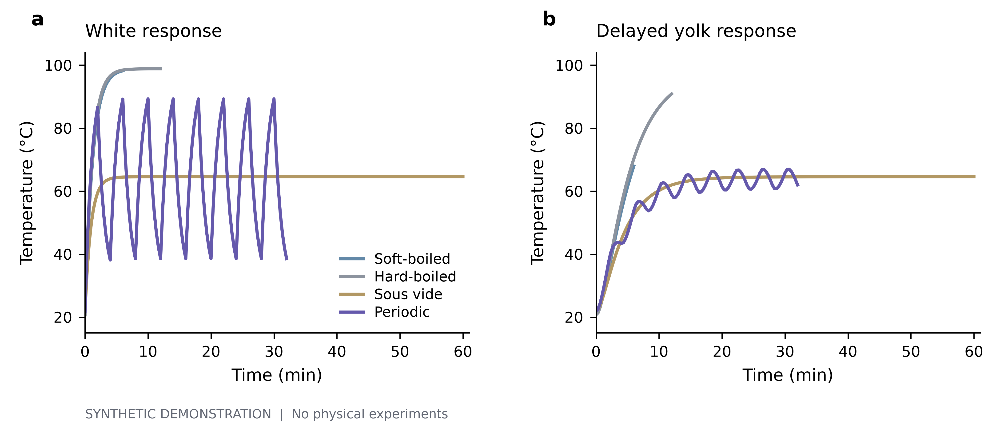
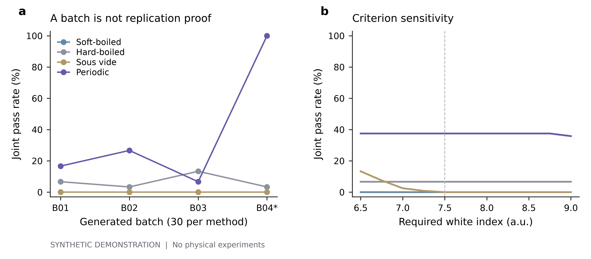
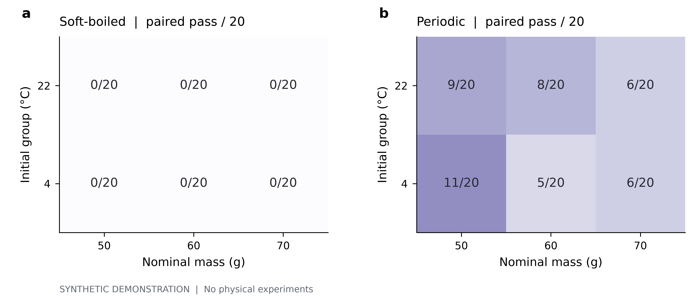

# 摘要

**目的。** 展示如何在同一项目中，把可拆分的研究问题、数据与脚本、证据和论文组织为可检查的研究链。科学问题是：蛋白与蛋黄的两个目标能否在同一枚蛋上兼顾，以及这种兼顾能否稳定复现。

**方法。** 采用公开、未校准的双节点热响应与累计反应代理模型，生成4种程序、4个批次、3档质量和2档初温的480枚模拟蛋。所有样本均以sample_id配对。计算40,080条温度记录，但独立样本计数仍为480。保留4个缺失蛋白读数的样本，不插补，并保守地用全部样本作为主要分母。

**结果。** 周期程序配对达标45/120（37.5%，名义95% Wilson区间29.4%–46.4%）；沸水12分钟为8/120，其他两种程序在本次判据下为0/120。周期程序的平均蛋白与蛋黄指数分别为9.74和8.26，均落在其目标范围，但这并不意味着大多数个体配对达标。周期程序跨批次达标率从6.7%到100.0%。

**结论。** 在这组明确构造的模拟数据中，周期程序出现了配对达标样本，整体均值却掩盖显著的批次差异。示例不能证明现实中周期煮蛋的稳定性；它说明科研平台应保留样本身份、来源、分母和未决问题，而不只展示一个总平均值。

# 1　背景与研究问题

公开研究提出通过冷热交替边界条件调节蛋内不同区域的受热过程[1]。本示例借用其程序名称与处理时长作为背景，另建一个低维、现象学模型；没有导入该论文的实验数据、图像、拟合参数或CFD结果，也不声称复现其科学结论。

本项目并列维护两个问题。Q1：同一枚蛋能否同时满足蛋白凝固与蛋黄柔软的操作性目标？其子问题分别检查蛋白目标、蛋黄目标以及二者是否在同一样本上出现。Q2：观察到的配对达标能否跨批次稳定复现？其子问题检查质量与初温分层、批次过程变化及判据敏感性。父问题保留独立的分析、证据和结论，不自动由子问题状态替代。

# 2　方法

## 2.1　设计与生成来源

采用4×4×3×2×5的平衡设计：4种程序、4个批次、标称质量50/60/70 g、标称初温4/22°C，每格5个模拟重复，共480枚；每种程序120枚，每批每程序30枚，每个程序的质量/初温格20枚。质量、初温、传热时常和测量噪声按公开脚本生成，随机种子为20261029。所有数值均为合成值，`is_simulated=True`。

程序为沸水6分钟、沸水12分钟、65°C恒温60分钟，以及100/30°C每2分钟切换、持续32分钟的周期条件。温度上限在模型中限定为100°C。B04的周期程序在固定32分钟总长内将每个热半周期延长20秒，并有相应的温控偏移；该变化在配置和逐行数据中记录，没有被事后删除。

## 2.2　热响应与质构代理

令Tw和Ty分别为蛋白、蛋黄节点温度，Tb为水浴边界。采用 $\frac{dT_w}{dt}=\frac{T_b-T_w}{\tau_w}$ 及 $\frac{dT_y}{dt}=\frac{T_w-T_y}{\tau_y}$，时常按质量的2/3次方缩放，并加入公开生成的个体差异。以2秒步长积分，每20秒记录温度。名义时常为66秒和270秒；完整参数与批次偏移见protocol.json。

质构指数由温度依赖的指数速率累积后映射至0–10，再叠加测量噪声。蛋白指数越高表示代理模型中的凝固程度越高；蛋黄指数越高表示越软，过高也可能不在“柔软但成形”的目标区间。两个指数都没有经过实物标定，不是蛋白质变性率、感官评分或食品安全标准。

## 2.3　判据、配对与质量检查

在对生成数据分类前，固定演示判据：蛋白指数≥7.5，蛋黄指数处于闭区间[5.0,8.5]，并且两个条件在同一个sample_id同时成立。4行蛋白读数缺失被标为不可判定，不进行插补；主要达标率的分母包含这些行，完整样本口径另存于汇总表。没有基于结果的样本剔除。

95% Wilson区间仅描述模拟蛋级二项计数，未对批内相关性进行调整，不能作为现实人群或未来批次的验证区间。批次结果单独展示；只报告描述性差异，不进行显著性检验或因果推断。判据敏感性在蛋黄区间固定时，将蛋白下限从6.5改变到9.0。

# 3　结果

## 3.1　不同处理程序产生不同的内外温度轨迹

蛋白节点较快追随水浴，而蛋黄节点的响应更迟缓。周期边界在蛋白节点留下较大的波动，在蛋黄节点表现为较小的波动与滞后；恒温程序趋于共同平台。这里显示的是四枚按设计身份选定的参考模拟蛋，不把一条长时间序列视为更多的生物学重复。

{width=16cm}

## 3.2　“平均值合适”掩盖了个体配对结果

| 程序 | 全部样本 | 可判定 | 配对达标 | 达标率 | 名义95%区间 |
|:--|--:|--:|--:|--:|:--|
| 沸水6分钟 | 120 | 117 | 0 | 0.0% | 0.0%–3.1% |
| 沸水12分钟 | 120 | 120 | 8 | 6.7% | 3.4%–12.6% |
| 65°C恒温60分钟 | 120 | 119 | 0 | 0.0% | 0.0%–3.1% |
| 冷热交替32分钟 | 120 | 120 | 45 | 37.5% | 29.4%–46.4% |

周期程序的平均指数同时满足演示阈值，而逐个样本判断仅45枚配对达标。恒温程序主要受蛋白目标限制；较长沸水程序主要受蛋黄目标限制。总平均值、两个边际比例和同一样本的联合事件不能互相替代。

![图2　均值合适不等于同一枚蛋同时达标。a显示476个读数完整样本的配对质构指标；浅色区域为白指数≥7.5且黄指数处于[5.0,8.5]。缺失的4行不在二维散点上显示，但没有从分析中删除。b为达标个数/全部120枚，误差线是名义95% Wilson区间，不处理批内相关性，仅为合成数据的描述。](../figures/fig2_joint.png){width=16cm}

## 3.3　单批成功不能证明稳定复现

| 周期程序批次 | 配对达标/总数 | 达标率 |
|:--|--:|--:|
| B01 | 5/30 | 16.7% |
| B02 | 8/30 | 26.7% |
| B03 | 2/30 | 6.7% |
| B04* | 30/30 | 100.0% |

周期程序在B04表现最好，但该批次同时具有过程变化和温控偏移。因此不能将更高达标率单独归因于任一因素，更不能据此宣称默认周期程序已经稳定。相较于全部样本汇总，保留批次维度给出了不同的研究判断：存在可行样本与具备稳定方法，是两个需要分别回答的问题。

{width=16cm}

# 4　讨论

本例最有用的结果不是宣布一种“完美煮蛋法”，而是展示研究认识如何受到数据粒度和证据范围约束。Q1在模型内部获得了有限的可行性证据，Q2则仍然没有稳定性支持。B04可提出新的热端占空比假设，但它不是随机化干预，也不能替代受控比较。

平台中的分析脚本读取完整CSV，绘图脚本读取分析输出，论文从汇总JSON与图表组装。证据链接保留对象修订；原始文件、缺失行和运行记录可独立下载。改变判据后应重新运行分析并产生新结果，而不是只手动改论文中的数字。

下一步的演示计划是：保持批次温控偏移不变，单独比较50%与58.3%的热端占空比，再使用新的模拟批次或真实测量检验。真实研究还需校准质构指标、检验热模型、控制样本属性并满足适用的食品安全要求。本例不提供食用安全或烹调建议。

# 5　限制与复现

全部数据由一个未校准的生成模型产生，因此处理差异部分来自模型设计；四个模拟批次并不构成实物验证。未观察的热史、批次内依赖、质构量表和缺失机制都可能改变结果。此处没有感官实验、仪器测量、营养组学或微生物安全评估。研究结论仅限于这一次公开生成过程及其判据。

按顺序执行01_simulate.py、02_analyze.py、03_plot.py和04_write_paper.py，可重新生成全部数据、汇总表、图和文稿。运行回执记录命令、实际退出码、代码与文件SHA-256。平台内的DOCX和LaTeX为本次批量生成的两份独立保存稿；在编辑器中修改其中一份不会自动改写另一份。

# 数据与代码可用性

data/observations.csv含480行原始模拟观测，data/temperature_traces.csv含40,080行温度记录；data/data_dictionary.json定义变量与缺失；protocol.json定义生成模型和演示判据；results/包含分类、分层、敏感性与质量检查。figures/包含可编辑SVG/PDF与PNG。所有数据和分析代码随示例提供。模拟数据与真实实验数据明确分开登记。

# 参考文献

[1] Di Lorenzo E. et al. Periodic cooking of eggs. Communications Engineering 4, 5 (2025). https://doi.org/10.1038/s44172-024-00334-w （仅作为背景与程序灵感；本示例未使用该论文原始数据。）

# 补充结果

{width=16cm}
